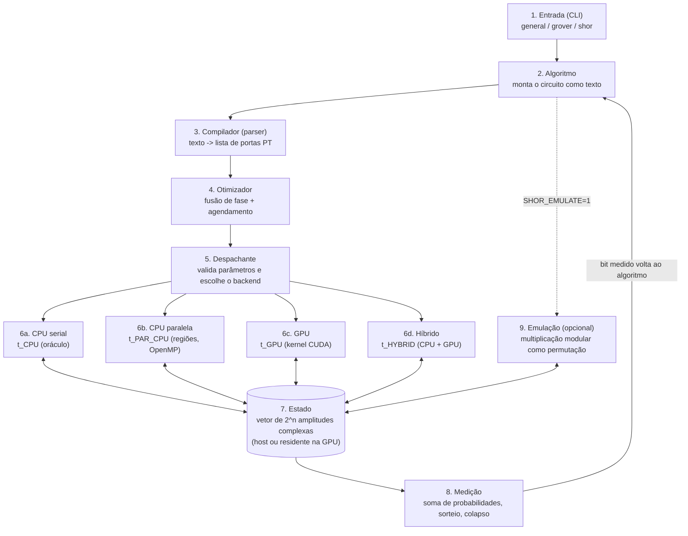
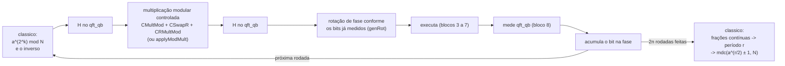

# O simulador em blocos operacionais

Este documento é o mapa de alto nível: cada **bloco** recebe uma coisa, produz
outra e tem um lugar no código. Os detalhes de cada bloco estão nos documentos
01 a 08; aqui interessa o encaixe entre eles. As referências de arquivo são do
C++ no tag final (ver [09](09-plano-migracao-rust.md)); o Rust manterá os mesmos
blocos.

## 1. Visão geral

O fluxo é um laço: o algoritmo monta um trecho de circuito, o simulador o executa
sobre o estado, mede, e o resultado clássico decide o próximo trecho (no Shor, a
fase medida até agora; no Grover, quantas iterações faltam).

## 2. Bloco a bloco

### Bloco 1: Entrada (CLI)
- **Recebe:** argumentos de linha de comando (número de qubits, backend,
  threads/GPUs) e variáveis de ambiente de ajuste (`GPU_FUSE`, `HYBRID_PIN`,
  `SHOR_EMULATE`...).
- **Produz:** uma chamada à biblioteca do algoritmo e a impressão do resultado.
- **Onde:** `src/cli/` (`general.cpp`, `grover.cpp`, `shor.cpp`).

### Bloco 2: Algoritmo
- **Recebe:** parâmetros do problema (n qubits, N a fatorar, item a buscar).
- **Produz:** circuitos escritos como **texto**, um *passo* por camada de portas
  (`"H,Control1(1),Target1(X)"`), e a decisão clássica entre as execuções.
- **Onde:** `lib_general.cpp`, `lib_grover.cpp`, `lib_shor*.cpp`; os geradores de
  portas estão em `gates.cpp` ([02](02-linguagem-de-circuitos.md)).

### Bloco 3: Compilador (parser)
- **Recebe:** a string do passo.
- **Produz:** uma lista de `PT`: **uma porta de 1 qubit já compilada** (matriz
  2x2, bit alvo, máscara/valor dos controles), terminada por `NULL`.
- **Detalhe que importa:** o qubit `q` do circuito é o bit `qubits-1-q` do índice
  do estado (qubit 0 = bit mais significativo).
- **Onde:** `dgm_parser.cpp` (`genGroups`, `genPTs`).

### Bloco 4: Otimizador (só para GPU)
- **Recebe:** a lista de `PT`.
- **Produz:** uma lista equivalente e mais barata:
  - *fusão de fase* (`FusePhaseRuns`): uma corrida de portas diagonais (Z, R1-R3,
    rotações da QFT) vira **uma** porta fundida, uma multiplicação por
    `e^{i·fase(idx)}` com tabela de 65536 entradas;
  - *agendamento* (`ScheduleForBatching`): reordena portas que **comutam** para
    caberem mais por passada sobre o estado, preservando a ordem de todo par que
    não comuta.
- **Onde:** `gate_fuse.cpp`, `gate_schedule.cpp`, `DGM::scheduleForGpu`.

### Bloco 5: Despachante
- **Recebe:** a lista de `PT` e o `exec_type`.
- **Produz:** a chamada ao backend certo, depois de **clampar** os parâmetros de
  região contra o número de qubits (`validateTuning`).
- **Onde:** `DGM::execute` em `dgm_core.cpp`.

### Bloco 6: Backends (os quatro calculam a mesma coisa)
Toda porta de 1 qubit só mistura pares de amplitudes cujos índices diferem no bit
alvo: `novo[p0] = m00·s[p0] + m01·s[p1]`, `novo[p1] = m10·s[p0] + m11·s[p1]`. A
matriz classificada como `DENSE`, `DIAG_PRI` (diagonal) ou `DIAG_SEC`
(anti-diagonal) escolhe o caminho mais barato.

| Bloco | Estratégia | Onde |
|---|---|---|
| **6a `t_CPU`** | um laço sobre o vetor; truques de bit geram os pares sem testar controle a cada posição. É o **oráculo** dos testes | `dgm_cpu_exec.cpp` |
| **6b `t_PAR_CPU`** | divide o vetor em **regiões** (fixando alguns bits do índice) e processa regiões em threads diferentes | `dgm_par_exec.cpp` |
| **6c `t_GPU`** | cada bloco CUDA carrega uma região na **memória compartilhada**, aplica um lote de portas e grava de volta; até 300 portas por lote; corpo especial para a porta de fase fundida | `kernel.cu` ([04](04-gpu-cuda.md)) |
| **6d `t_HYBRID`** | um thread comanda a GPU enquanto os demais processam regiões na CPU. Se o estado inteiro cabe na GPU, delega tudo a ela | `dgm_par_exec.cpp` |

### Bloco 7: Estado
- **O que é:** `2^n` amplitudes complexas de 32 bits (`float complex`); a posição
  `i` é a amplitude da base computacional `|i>`. É a memória do simulador, e ela
  dobra a cada qubit (27 qubits = 1 GiB).
- **Sessão de GPU:** no Shor o estado fica **residente na GPU** entre as rodadas,
  sem copiar host <-> GPU a cada execução (`beginGpuSession`).
- **Onde:** `DGM::state`, `allocateMemory` (`dgm_core.cpp`).

### Bloco 8: Medição
- **Recebe:** o qubit a medir.
- **Faz:** soma `|amplitude|²` das metades com o bit em 0 e em 1; sorteia o
  resultado com o gerador de números aleatórios; **colapsa** o estado (zera a
  metade descartada e renormaliza). Em sessão de GPU, soma e colapso rodam lá.
- **Produz:** um bit clássico para o algoritmo.
- **Onde:** `DGM::measure`, `GpuMeasureSums`, `GpuCollapse`.

### Bloco 9: Emulação (opcional, só no Shor)
- **Faz:** a multiplicação modular controlada de cada rodada (centenas de portas
  no circuito de Beauregard) vira **uma permutação dos índices do estado**:
  se o controle vale 1, o registrador passa de `x` para `a·x mod N`.
- **Ganho medido:** `shor.out 27` em GPU de 43,5 s para 1,2 s.
- **Custo:** deixa de ser um circuito; o circuito exato continua sendo o oráculo
  nos testes. Ativa com `SHOR_EMULATE=1`.
- **Onde:** `DGM::applyModMult`, `GpuModMult` (item 29 de
  [07](07-bugs-e-pontos-de-atencao.md)).

## 3. Exemplo completo: estado de Bell com 2 qubits

Circuito: `"H,ID"` e depois `"Control1(1),Target1(X)"` (H no qubit 0, CNOT com
controle no 0 e alvo no 1). Índice do estado: `b1 b0`, com o qubit 0 = bit 1 (índice 0 = `00`, 1 = `01`, 2 = `10`, 3 = `11`).

| Passo | Bloco | O que acontece | Estado `[s0, s1, s2, s3]` |
|---|---|---|---|
| início | 7 | `setMemoryValue(0)` | `[1, 0, 0, 0]` |
| `"H,ID"` | 3 -> 6 | parser gera 1 `PT` (H, bit alvo 1, sem controle); o backend mistura o par de índices (0, 2) | `[0,707, 0, 0,707, 0]` |
| `"Control1(1),Target1(X)"` | 3 -> 6 | 1 `PT` (X anti-diagonal, controle no bit 1 valendo 1, alvo no bit 0); troca os índices 2 e 3 | `[0,707, 0, 0, 0,707]` |
| `measure(0)` | 8 | `P(0) = P(1) = 0,5`; sorteia, colapsa e renormaliza | `[1,0,0,0]` ou `[0,0,0,1]` |

Medir o qubit 1 depois dá sempre o mesmo valor que o qubit 0: é o emaranhamento.

## 4. Exemplo de laço clássico + quântico: uma rodada do Shor

O Shor usa **um único qubit de controle** (`qft_qb`), reaproveitado em `2n`
rodadas (estimação de fase semiclássica). Layout: `qft_qb`, `reg1`, `over`,
`reg2`, `over_bool` (`2n+3` qubits para um `N` de `n` bits).

`CRMultMod` precisa receber o **inverso modular** de `a^(2^k)`: depois da troca
`reg1 = a·x` e `reg2 = x`, subtrair `a⁻¹·(a·x)` devolve `reg2` a zero (era o item
30, corrigido).

## 5. Onde o tempo vai (por que os blocos são do jeito que são)

- O simulador é **limitado por banda de memória**: cada porta lê e escreve o vetor
  inteiro. Daí vêm os blocos 4 (menos passadas) e 6c (carregar uma região na
  memória rápida e aplicar várias portas nela).
- Portas de fase custam ~4x uma porta normal na GPU mesmo sendo "só uma
  multiplicação" (instruções por amplitude, não custo fixo por porta); por isso
  a fusão e o corpo especial do kernel.
- No Shor, a maior parte do tempo estava na multiplicação modular, e é por isso
  que o bloco 9 (uma passada no lugar de centenas) deu o maior ganho medido.

## 6. Mapa para o Rust

| Bloco | Crate proposto |
|---|---|
| 1 Entrada | `hgm-cli` |
| 2 Algoritmo | `hgm-algos` |
| 3 Compilador, 4 Otimizador | `hgm-core` |
| 5 Despachante, 8 Medição (lógica) | `hgm-engine` |
| 6a/6b CPU | `hgm-cpu` |
| 6c GPU, 9 Emulação (GPU) | `hgm-gpu` |
| 6d Híbrido | `hgm-engine` |
| 7 Estado | tipo em `hgm-core`, buffers em `hgm-cpu`/`hgm-gpu` |
